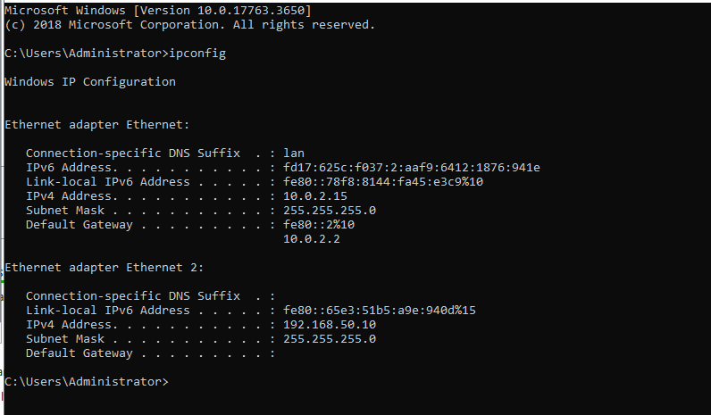
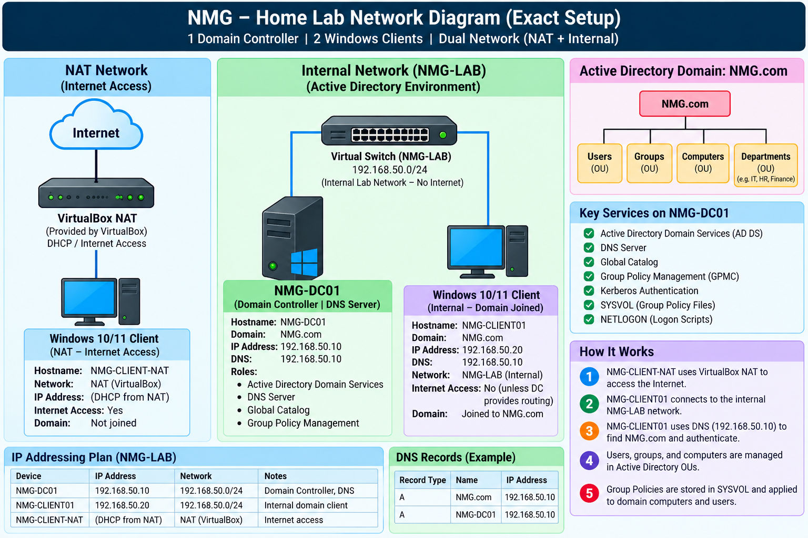
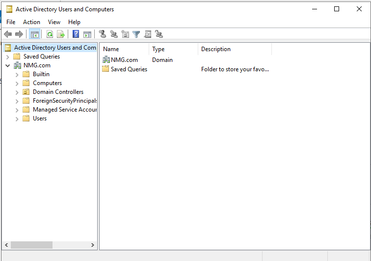

# Day 01 — Your First Day on the Job

## 1. Overview

As part of the **TotalThreat 7-Day Portfolio Challenge**, I take on the simulated role of a Junior IT & Identity Support Specialist at Northstar Medical Group (NMG).

The organization faces challenges involving manual employee onboarding, inconsistent permissions, unorganized departments, and overprivileged accounts.

Before addressing these identity management problems, I needed to establish the foundational infrastructure for centralized authentication and user management.

**Day 1 Goal:** Deploy Windows Server 2019, configure Active Directory Domain Services, establish the NMG.com domain, and verify basic domain functionality.

## 2. Lab Environment

| Component | Configuration |
|---|---|
| Hypervisor | Oracle VirtualBox |
| Operating System | Windows Server 2019 |
| Server Name | NMG-DC01 |
| Domain | NMG.com |
| NAT IP Address | 10.0.2.15 |
| Internal Network | NMG-LAB |
| Internal IP Address | 192.168.50.10 |
| Subnet Mask | 255.255.255.0 |
| Internal DNS Server | 192.168.50.10 |
| Server Roles | Active Directory Domain Services and DNS |

## 3. Network Configuration

Configured two network adapters on the same Windows Server virtual machine.

**Adapter 1 — NAT**

- IP Address: 10.0.2.15
- Default Gateway: 10.0.2.2
- DHCP: Enabled
- Purpose: External network connectivity

**Adapter 2 — Internal Network**

- Network Name: NMG-LAB
- Static IP Address: 192.168.50.10
- Subnet Mask: 255.255.255.0
- Default Gateway: None
- DNS Server: 192.168.50.10
- Purpose: Isolated Active Directory lab network

Executed:

`ipconfig /all`

### Screenshot 1 — Network Configuration

The screenshot below shows both network interfaces, including their IP addresses and network settings.

  

**Verification:** Confirmed that NMG-DC01 has two configured network interfaces serving different purposes.

## 4. Active Directory Domain Services Installation

Installed Active Directory Domain Services (AD DS) using Windows Server Manager.

Promoted the server to a Domain Controller by creating a new Active Directory forest.

**Configuration:**

- Domain: NMG.com
- Domain Controller: NMG-DC01
- DNS Server: Enabled
- Global Catalog: Enabled

After promotion, Windows Server restarted to complete the configuration.

### Screenshot 2 — Active Directory Domain Verification

The screenshot below shows Active Directory Users and Computers, confirming that NMG.com and its default containers were created.

**Verification:** Confirmed that the Active Directory domain was accessible through the management console.

## 5. DNS Configuration and Validation

DNS is essential for Active Directory because it enables domain name resolution and helps systems locate domain services.

Configured the internal network interface to use the Domain Controller as its DNS server:

`192.168.50.10`

Executed:

`nslookup NMG.com 192.168.50.10`

**Observed result:** NMG.com successfully resolved to `192.168.50.10`.

**Verification:** Confirmed that the DNS server could resolve NMG.com to the Domain Controller's internal IP address.

## 6. Challenges and Troubleshooting

### Network Configuration

Understanding the difference between VirtualBox NAT and Internal Network adapters was an important part of the setup.

I learned how to configure a static IP address for the internal network while maintaining separate NAT connectivity.

### DNS Configuration

I learned how Active Directory depends on DNS and why correct DNS configuration is essential for domain services.

### Domain Verification

After installing Active Directory, I used Active Directory Users and Computers and `nslookup` to confirm that the domain was created and name resolution was functioning.

## 7. Day 1 Results

By the end of Day 1, I successfully:

- Deployed Windows Server 2019 in VirtualBox.
- Configured NAT and internal networking.
- Installed Active Directory Domain Services.
- Created the NMG.com domain.
- Promoted NMG-DC01 to a Domain Controller.
- Configured DNS services.
- Verified the Active Directory domain.
- Confirmed successful DNS name resolution.

## 8. Lessons Learned

Day 1 helped me understand the relationship between Windows Server, Active Directory, DNS, Domain Controllers, and virtual networking.

I also learned the importance of verifying technical configurations rather than assuming an installation was successful.

## 9. Conclusion

Day 1 established the foundational Active Directory infrastructure for Northstar Medical Group's simulated identity management environment.

The Domain Controller and basic DNS resolution are operational, providing a foundation for the next stages of the challenge.

**Next: Day 02 — Organizing Chaos**
