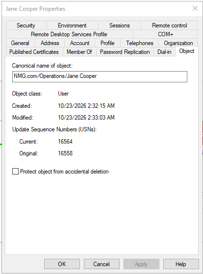
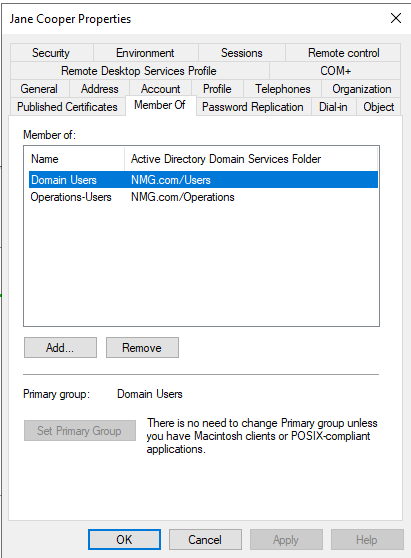
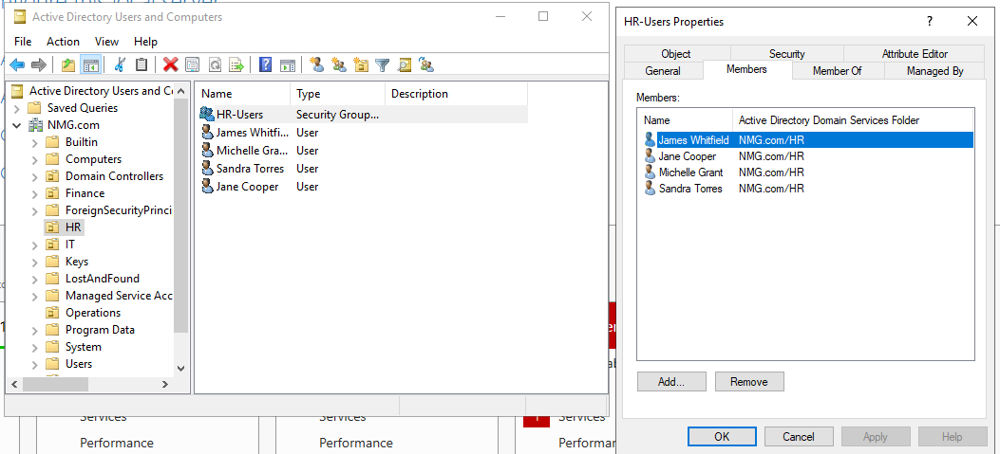

# Day 4 — First IT Support Ticket: NMG-0047

## Project Overview

On Day 4 of my Northstar Medical Group (NMG) Active Directory Home Lab, I investigated and corrected my first simulated IT support ticket.

The objective was to develop practical troubleshooting skills by identifying the root causes of an employee's access problems, applying appropriate corrections, and documenting the results.

**Ticket:** NMG-0047  
**Affected User:** Jane Cooper (`jcooper@NMG.com`)  
**Position:** HR Payroll Specialist  
**Domain:** NMG.com

---

## Phase 1 — Investigation

### 1. Incident Description

Jane Cooper reported two problems:

- Unable to access HR shared resources.
- Desktop policies and mapped drives differed from her HR colleagues.

Before making any changes, I investigated her Active Directory account.

### 2. Investigating OU Placement

Using Active Directory Users and Computers, I searched for Jane Cooper's account and reviewed her Object properties.

**Finding:** Jane's account was located in the Operations OU instead of HR.

This could explain her incorrect desktop policies because different Organizational Units may have different Group Policy Objects applied.

### 3. Investigating Security Group Membership

Next, I examined Jane's Member Of tab.

**Finding:** Jane belonged to:

- Domain Users
- Operations-Users

She was not a member of HR-Users.

This could explain her inability to access HR resources if access permissions were assigned to HR-Users.

### 4. Root Cause Assessment

I identified two Active Directory configuration problems:

1. Incorrect OU placement.
2. Incorrect security group membership.

These findings were consistent with the reported symptoms, although actual folder permissions and Group Policy application were not independently tested.

---

## Phase 2 — Remediation and Verification

### 5. Correcting the Organizational Unit

I moved Jane Cooper from the Operations OU to the HR OU.

After the change, I verified that her canonical name was:

`NMG.com/HR/Jane Cooper`

This placed Jane in the appropriate organizational structure for her HR role.

### 6. Correcting Security Group Membership

I made the following changes:

- Added Jane to HR-Users.
- Removed Jane from Operations-Users.
- Preserved Domain Users membership.

These corrections followed the Principle of Least Privilege and Role-Based Access Control.

### 7. Final Active Directory Verification

I opened the HR-Users security group and checked its Members tab.

Jane Cooper appeared alongside the authorized HR employees.

**Verified results:**

- Jane is located in the HR OU.
- Jane belongs to HR-Users.
- Operations-Users membership has been removed.
- Domain Users membership remains unchanged.

**Verification limitation:** The HR shared folder was not configured in this lab. Therefore, actual HR folder access, mapped drives, and desktop policies were not tested.

---

## Phase 3 — Incident Documentation

### Ticket Summary

**Ticket Number:** NMG-0047  
**Affected User:** Jane Cooper  
**Issue:** HR resource access and desktop configuration problems

**Identified configuration problems:**

- Incorrect Organizational Unit placement.
- Incorrect security group membership.

**Corrective actions:**

- Moved Jane Cooper to the HR OU.
- Added HR-Users membership.
- Removed Operations-Users membership.

**Verification:** Confirmed the corrected OU and group memberships through Active Directory Users and Computers.

**Ticket Status:** Pending functional verification.

---

## Cybersecurity Concepts Learned

### 1. Role-Based Access Control (RBAC)

Users should receive access based on their assigned organizational responsibilities.

### 2. Principle of Least Privilege

Employees should only receive the permissions necessary to perform their job duties.

### 3. Organizational Units and Group Policy

OU placement helps determine which Group Policy Objects apply to Active Directory users and computers.

### 4. Security Group Permissions

Security groups simplify permission management by assigning access to groups rather than individual employees.

### 5. Incident Documentation

Recording the original configuration, corrective actions, and verification results provides evidence for future troubleshooting and auditing.

---

## Conclusion

During Day 4, I successfully investigated and corrected two Active Directory configuration issues affecting Jane Cooper.

This exercise strengthened my understanding of Active Directory administration, access control, troubleshooting, and technical documentation.

Most importantly, I learned that **correcting a configuration does not automatically prove that the original user-facing issue has been resolved**.

Further functional testing will be required before closing Ticket NMG-0047.
